# Windows before and after

Captured on Windows 11 Pro (10.0.26300, x64) from real windows. Each "before"
comes from a build of the `windows` branch without the change, each "after" from
the branch with it.

| Change | Before | After |
| --- | --- | --- |
| Installer shows Herdr's icon instead of Inno Setup's stock graphic |  | 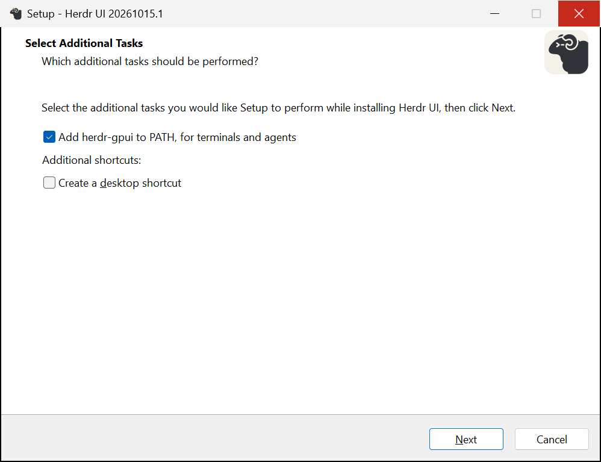 |
| `herdr-gpui.exe` carries a name, version, and icon (Properties → Details) |  | 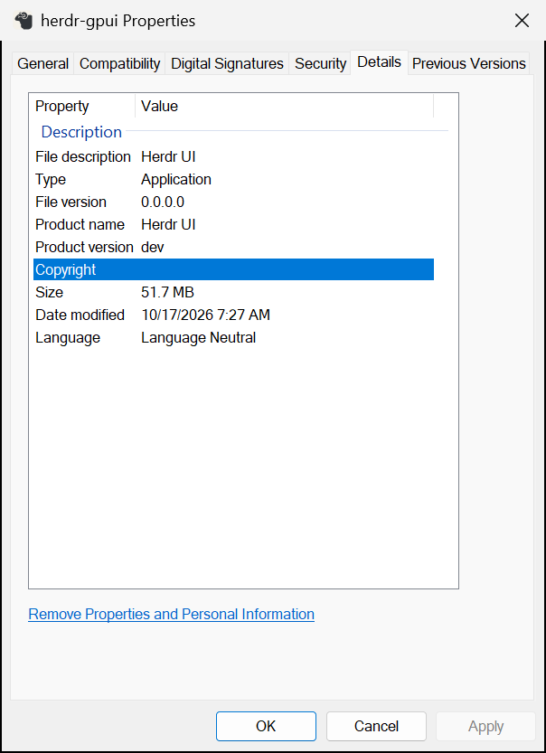 |
| Ctrl-V in a WSL pane: "Image not sent" before; text pastes after (Ctrl-Shift-V shown, Ctrl-V reaches the shell as a key) |  |  |
| CPU and memory of a WSL distribution in the sidebar and status bar (25% under an 8-thread load) | 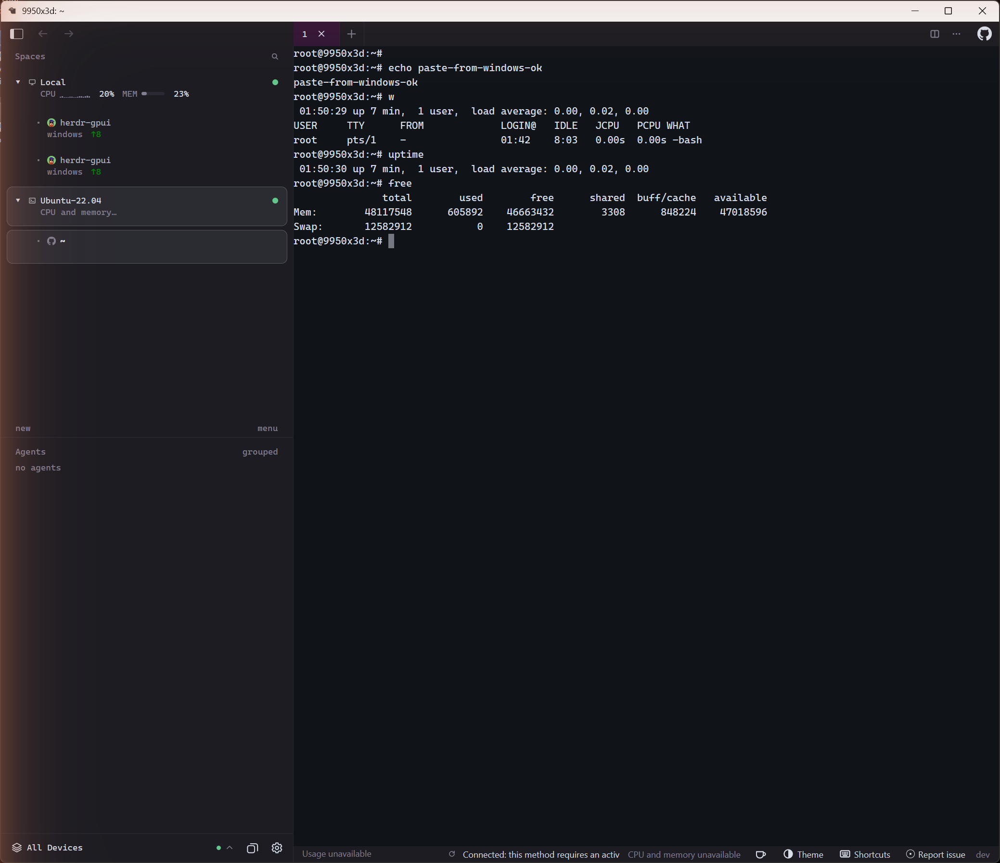 |  |
| Title bar follows the app's dark theme under light Windows (a light theme keeps a light one: ) | 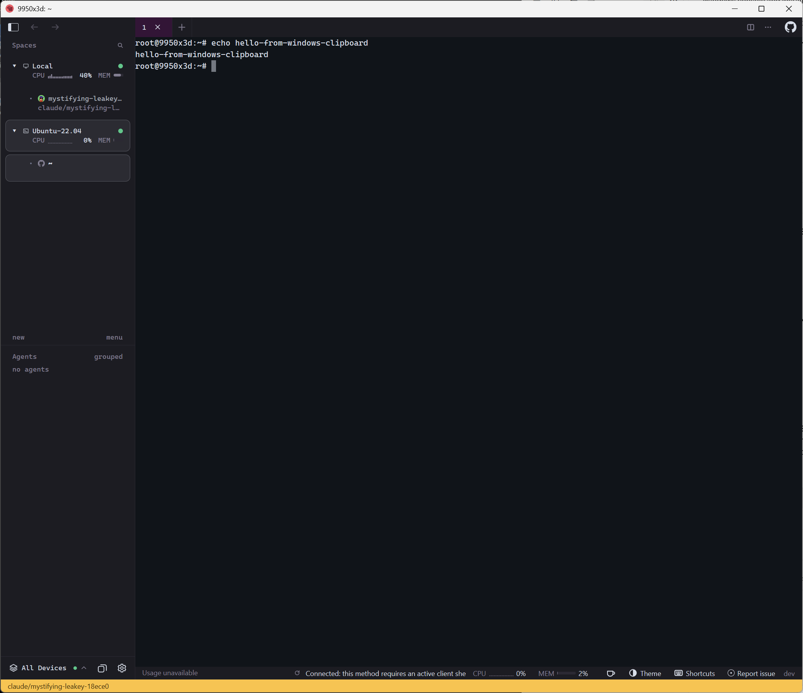 |  |
| `[backdrop] opacity = 0.6, blur = true`: composition blur under a solid title bar before; DWM acrylic over the window and title bar after | 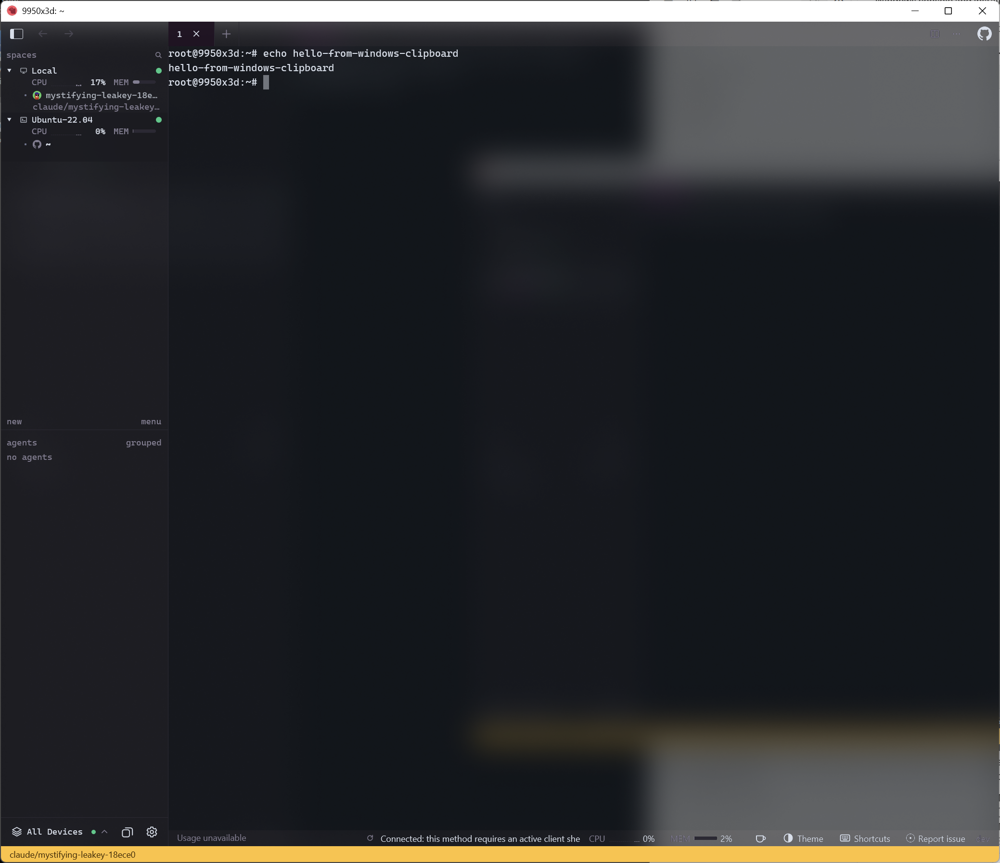 |  |
| `material = "mica"` (after only: Mica tints the window with the wallpaper, not the windows behind) | |  |
| `accent = "system"`: the current tab takes the Windows accent (this machine's is gray, #767676) instead of the theme's purple | 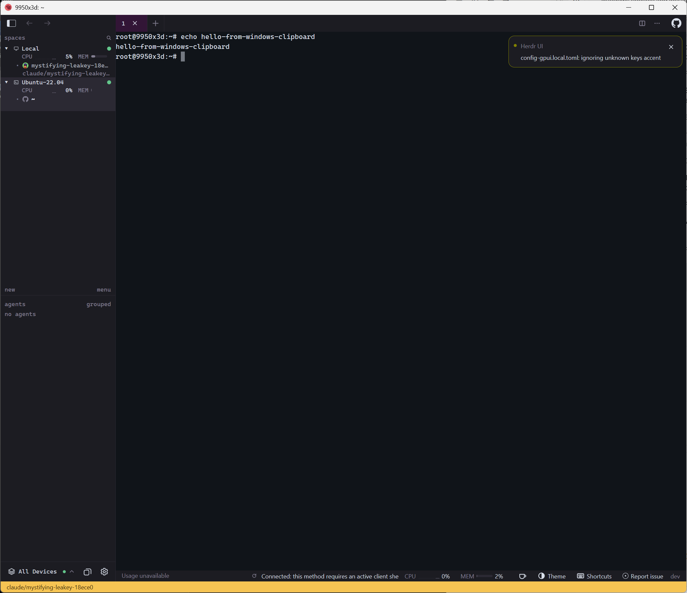 | 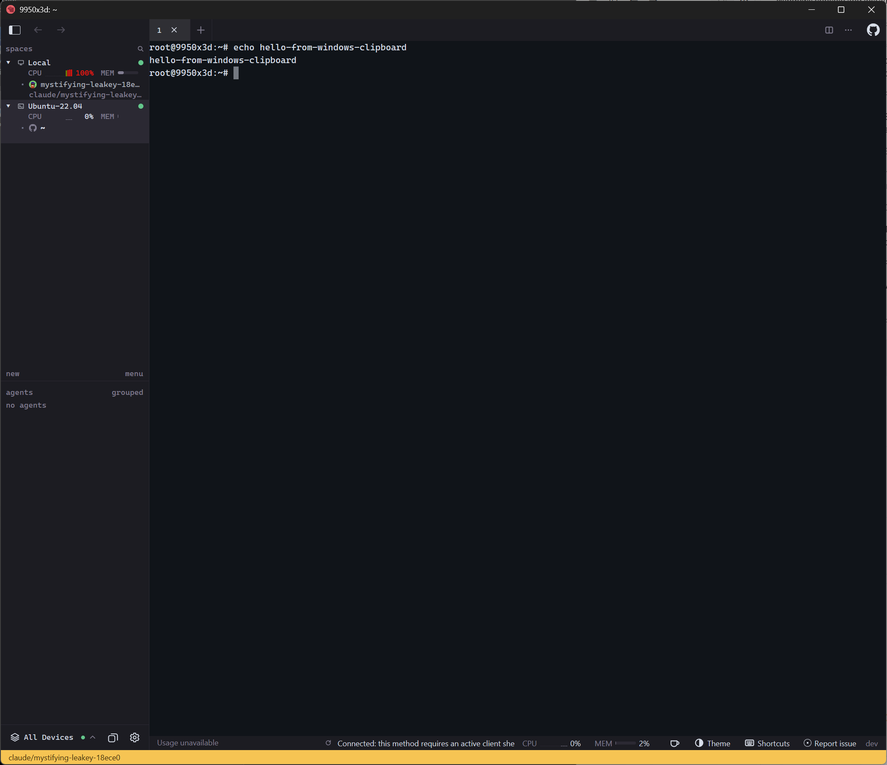 |

The "after" executable reports version 0.0.0.0 / dev because it is a local
build; release builds carry the release version.

The title bar, backdrop, and accent shots are screen captures of the window's
DWM frame bounds taken while it was in front: `PrintWindow` leaves out the
caption buttons and the backdrop material. The acrylic shots blur whatever was
behind the window.

## Snap Layouts

Herdr UI keeps the system-drawn title bar on Windows, so its maximize button
is the system's own and hovering it opens the Snap Layouts flyout. There is
nothing to capture between before and after; the window's hit-test answer
over its caption shows it (`WM_NCHITTEST` sent to the main window at 150%
scale, 25 px below its top edge):

| Point | Answer |
| --- | --- |
| 30 px from the right edge | `HTCLOSE` (20) |
| 100 px from the right edge | `HTMAXBUTTON` (9) |
| 160 px from the right edge | `HTMINBUTTON` (8) |
| elsewhere on the caption | `HTCAPTION` (2) |

## Screen readers

What UI Automation (and so Narrator) sees in the main window, read with
`System.Windows.Automation`'s control view.

Before:

```text
Window '9950x3d: ~'
  Document ''        (text pattern: the rows on screen)
```

After the first pass (title bar and tabs):

```text
Window '9950x3d: ~'
  Button 'Sidebar'           (expand/collapse)
  Button 'Back'
  Button 'Forward'
  Tab ''                     (selection)
    TabItem '1'              (selection item, selected)
      Button 'Close tab'     (invoke)
  Button 'New tab'           (invoke)
  Button 'Split'             (invoke)
  Button 'Tab actions'       (invoke)
  Button 'GitHub account'    (invoke)
  Document 'Terminal'        (text pattern: the rows on screen)
```

Now, with the menu bar, activity bar, sidebar, and status bar, read by
`crates/herdr-gpui/tests/support/uia_tree.ps1` from a window on an isolated
daemon with three workspaces (patterns and states in brackets):

```text
Window '9950X3D: ~' [Window, Transform]
  MenuBar 'Menu bar' [Invoke, Selection]
    MenuItem 'Herdr' [Collapsed]
    MenuItem 'File' [Collapsed]
    MenuItem 'Edit' [Collapsed]
    MenuItem 'View' [Collapsed]
    MenuItem 'Terminal' [Collapsed]
    MenuItem 'Window' [Collapsed]
  Button 'Sidebar' [Expanded]
  Button 'Back' [disabled]
  Button 'Forward' [disabled]
  Tab 'Activity' [Selection]
    TabItem 'Workspaces' [selected=True]
    TabItem 'Overview' [selected=False]
    TabItem 'Pull requests' [selected=False]
    TabItem 'Issues' [selected=False]
    TabItem 'Usage' [selected=False]
    Button 'Settings' [Invoke]
  Group 'Sidebar' []
    Edit 'Spaces' [Value]
    List 'Workspaces' []
      ListItem '~' [selected=True]
      ListItem 'proj-a' [selected=False]
      ListItem 'proj-b' [selected=False]
    Button 'New workspace' [Invoke]
    Button 'Menu' [Invoke]
    Button 'Sort agents: grouped' [Invoke]
    List 'Agents' []
    Button 'Devices: All Devices, connected' [Invoke]
    Button 'Sessions' [Invoke]
  Tab 'Tabs' [Selection]
    TabItem '1' [selected=True]
      Button 'Close tab' [Invoke]
  Button 'New tab' [Invoke]
  Button 'Split' [Invoke]
  Button 'Tab actions' [Invoke]
  Button 'GitHub account' [Invoke]
  Document 'Terminal' [Value, Text]
  StatusBar 'Status bar' []
    Text 'This machine / CPU 25% of 32 cores / Memory 36.1 GB of 93.7 GB (39%) / ...' []
    Button 'Keep the display awake' [toggle=Off]
    Button 'Theme' [Invoke]
    Button 'Shortcuts' [Invoke]
    Button 'Report issue' [Invoke]
    Button 'Version dev' [Invoke]
```

Where the keyboard goes, read from UI Automation's focused element after each
key sent to the window:

```text
F6        -> Button 'Sidebar'
Tab       -> TabItem '1'               (Back and Forward are unavailable)
F6        -> TabItem 'Workspaces'      (the sidebar starts at its activity bar)
Tab x5    -> TabItem 'Overview', 'Pull requests', 'Issues', 'Usage', Button 'Settings'
Tab       -> ListItem '~'
Tab       -> ListItem 'proj-a'
Down      -> ListItem 'proj-b'
F6        -> Button 'Keep the display awake'
Shift+Tab -> Button 'Version dev'
Escape    -> Document 'Terminal'
F10       -> MenuItem 'About Herdr'
Down      -> MenuItem 'Command Palette, ctrl-shift-p'
```

The focused control carries an accent ring:

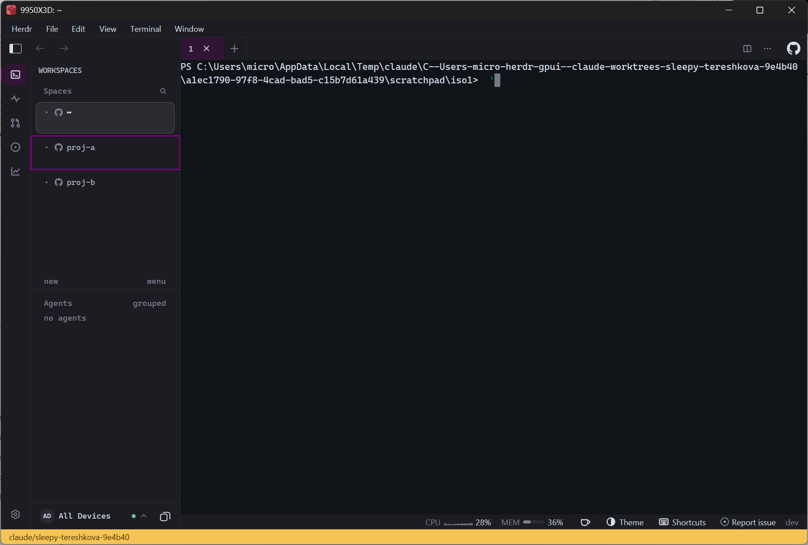

The Settings window:

```text
Window 'Settings' [Window, Transform]
  Group 'Settings sections' []
    Edit 'Search settings' [Value]
    Tab 'Sections' [Selection]
      TabItem 'General' [selected=False]
      TabItem 'Theme' [selected=True]
      ...
  Pane 'Theme' []
    Group 'Appearance' []
      RadioButton 'Light' [selected=False]
      RadioButton 'Dark' [selected=True]
      RadioButton 'System' [selected=False]
    Group 'Follow Herdr's theme' []
      Button 'Follow Herdr's theme' [toggle=Off]
    Group 'High contrast' []
      Button 'High contrast' [toggle=Off]
    ...
  StatusBar 'All changes saved.' []
  Button 'Reload' [Invoke]
```

Narrator itself was not run for these captures: the tree above is what it
reads, through the same UI Automation provider.

## Shell integration

Captured on the same machine against isolated Herdr sessions, with the
desktop or the window copied by PowerShell (`CopyFromScreen`, `PrintWindow`):
no clicks were made, so the jump list menu, the taskbar progress bar, and a
clicked toast banner are not shown. Before these changes the taskbar button had
no badge at all, as in the first image.

| Change | Capture |
| --- | --- |
| Taskbar badge: no agent needs attention |  |
| One blocked agent |  |
| Two |  |
| Ten or more |  |
| `herdr-gpui://open?path=…` for a checkout with no workspace asks first |  |
| The same link started by the Windows shell (`Start-Process`) from outside the app |  |
| A link to a folder that is not a Git checkout is refused in the status bar | 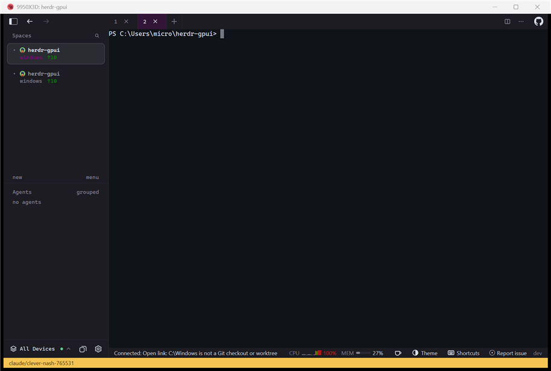 |
| The jump list's Show Local and Show Ubuntu-22.04 tasks' commands, run as the shell runs them | 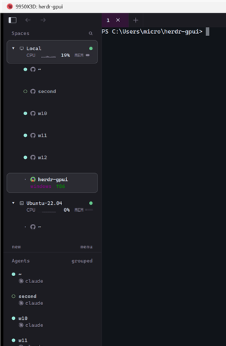  |
| A blocked agent's toast, before and after its protocol link (read from Windows' notification history) is run as a click runs it: the pane's workspace is focused | 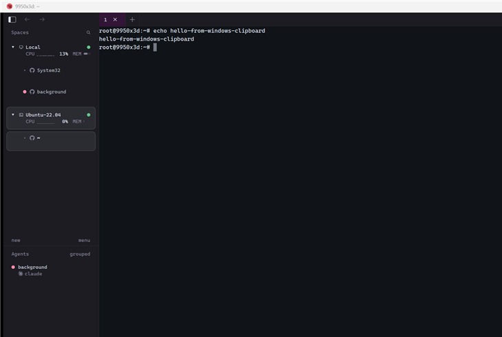 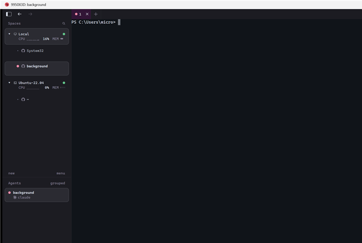 |
